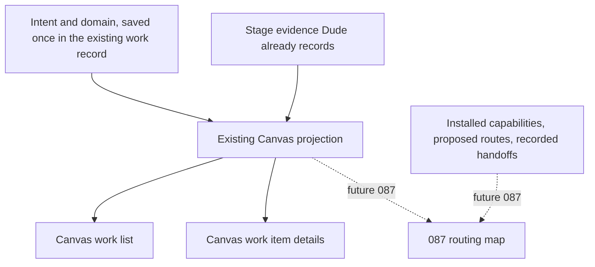
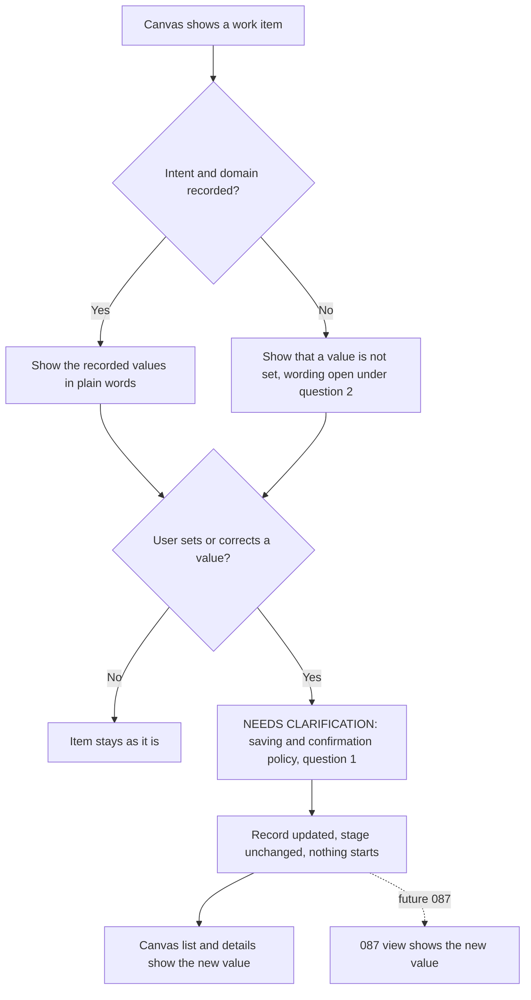
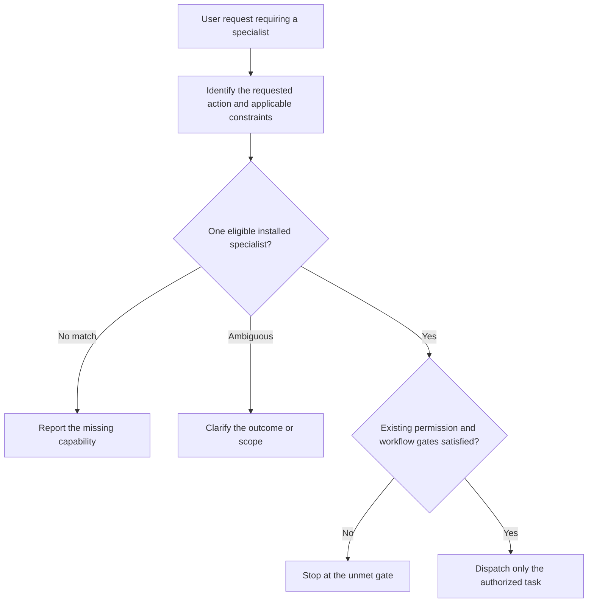

# Idea: Work Type Presentation

## Idea

Captured bugs should not be presented as ideas or features just because they share Dude's idea container. Capture the accepted recommendation for later: show work type separately from lifecycle stage across Canvas capture, lists, and details, following GitHub's familiar issue-type versus workflow-state distinction.

## Open Questions

For future definition; neither question blocks capture.

1. How should users select or correct type, and what authoritative source should supply it for new and existing records?
   Answer:
2. What final wording and mapping to existing records should present type and evidence-backed stage, including unknown or not-established information?
   Answer:

Questions 3 to 6 come from Dude's scenario exploration below. Question 3 records the user's answer; questions 4 to 6, like 1 and 2, wait for definition.

3. Should this idea keep type presentation-only, add each type's path (a Bug needs a reproduction and regression test), or put paths in a separate idea?
   Answer: In chat at 2026-10-19T19:55:10.575Z, the user agreed with Dude's recommendation that this idea covers presentation plus the shared classification its own Canvas screens need, and leaves type-specific workflow behavior out. The reply began "we agree"; the full message is recorded under Current Direction In Plain Words below.
4. Should defects or follow-ups found during other work, like the Reload slot leak from testing 084, become captured items naming where they surfaced, or stay in that feature's evidence?
   Answer:
5. Should bounded fixes and chores done directly without an idea, as 034's bug-or-chore route allows, appear in Canvas or stay out?
   Answer:
6. Should completed work show where it shipped, such as "Completed · Released in v1.9.0" from existing tags and merge commits, or stop at Completed?
   Answer:

Question 7 comes from the pack-owned workflow discussion below and records an open tradeoff, not a decision. It concerns the pack-workflow composition outcome, which has no idea of its own yet, so it stays here until that outcome is captured. Question 8 moved to 087. Question 9 records the user's answer about what this idea shows.

7. Should Dude normally select one primary workflow for each requested outcome and let it request bounded stages from other installed packs, or should one request freely combine several workflows?
   Answer:
8. Moved to `.dude/ideas/087-dude-canvas-routing-map.md` as its question 3, where its answer decides what the first map shows.
9. Should this idea show work intent (such as fix or create), the work's domain (such as code, design, writing, or video), or both?
   Answer: In chat at 2026-10-19T18:22:12Z, the user chose both. Literal reply: "both, you corrected me and that's great." The full message is recorded under Intent And Domain below.

Questions 10 and 11 come from the discussion under Progress Reporting below and wait for definition.

10. What should every progress report state, which existing records support each part in Lightweight and tracked work, and how should a part without evidence appear?
    Answer:
11. Should definition name phases in each domain's own terms, such as Mockup review, and what wording and evidence should show that an item is waiting for the user?
    Answer:

## Assumptions

No user-supplied assumptions recorded.

<!-- dude:managed:start -->
## Current Direction In Plain Words

At 2026-10-19T19:47:07.882Z, the user described how this idea relates to 087:

> I see Feature 67 and 87 very close nad related, we will work on 677 but want to make sure we set the foundations for 87

Dude reads "677" there as this idea, 067. Dude then recommended a direction, and at 2026-10-19T19:55:10.575Z the user replied:

> we agree, capture in hte brainstorom the analysis so far, then recap ELI5,  ADHD  what would be the design and architecture, add mermaid driagrams to the idea to visualize the intent or idea,

This section restates the agreed direction in plain words. The agreement does not accept every earlier label, proposal, or candidate outcome in this ledger, and it approves no schema, interface, mockup, or implementation. Points marked as Dude's recommendation or as open are not part of it. Progress Reporting below adds a later agreement under the same limits.

### What You Would See

Every work item would answer three questions:

| Question | Term | Example |
| --- | --- | --- |
| What are we trying to do? | Intent | Fix |
| What kind of work is it? | Domain | Code |
| How far has it got? | Stage | In progress |

Canvas lists and details would show all three, so an item might read Fix / Code / In progress. That is an example, not the status of any real item, and the exact words are still open.

- The three answers stay separate. Today Canvas uses one label, idea or feature, for both the kind of work and its stage, which is how a confirmed bug came to read as an idea.
- Canvas would work out the stage from evidence Dude already records, such as whether the idea is defined and how its tasks stand. Nobody would enter it by hand.
- The domain belongs to the request, whatever is installed. A video request is still Video when no installed pack can produce video.

### How It Works Underneath

Intent and domain would be saved once, in the record Dude already keeps for the item. Lifecycle numbers, paths, and other current identities stay as they are. Canvas would read the saved values through its existing projection, the code that already gathers Dude's records into its lists and details. This idea would extend that code, not copy it. Saved values and on-screen words stay separate, so wording can change without rewriting records.

Later, 087 would read the same values the same way, instead of parsing labels or keeping its own copy. It would also bring information from its own sources: installed capabilities, proposed routes, and handoffs that actually happened. "Fix / Code" alone says nothing about which agent did the work.

GitHub works the same way: an issue's list row, board card, and page all read one issue, so a label changed once changes everywhere. The pattern fits Canvas, which already shows the same work in more than one view, and 087 would add another.

Diagram 1, proposed and conceptual: where the information comes from and who reads it. Dashed lines are future 087 paths.



### Fixing A Wrong Value

If an item's domain is wrong, such as Writing where it should be Design, one correction would update every view that reads the record, including a future 087 view. The correction changes no lifecycle stage and starts no work. How a correction, or a value Dude suggests, becomes saved is still open under question 1.

Diagram 2, proposed: showing and correcting intent and domain. The open step is marked as needing clarification.



### Labels Do Not Grant Permission

The user's current request decides what Dude may do, within Dude's existing rules; an item's labels never do. If an item reads Fix / Code and the user asks Dude to "review this login fix", Dude does a read-only review and does not start implementing. In this idea, labels do not pick agents either; routing keeps working as it does today. Dude recommends keeping this distinction without a new stored action field, because the request already carries it.

Diagram 3, a simplified view of existing boundaries: what happens when a request needs a specialist. Direct answers and maintenance that the coordinator owns lie outside this picture. This idea adds no routing behavior. Classification supplies no permission, so an item's labels confer none.



### Progress Reporting

At 2026-10-19T21:25:11.921Z, the user raised a related point:

> anothre brainstomring , There's another thing related to this feature. When worling a task , these should have defined checkpoints describing the progress . For example in Kanban could be backlog, todo, in progress, done... 
>
> it doe snot necessarly has to be those. What I'd like to establish is to define some sort or "interface" ( borrowing from programming terms) in which a meta process asks for hte stauts or stage and the work being doem "knows" how to report back. Obviosuly thre are many dom,ains/intents asn htey might report differently describing in a different way. Thougths ?

At 2026-10-19T21:58:17.885Z, the user asked, "does it needs to be in a different draft? or would it be better if we plan ahead in 067?" Dude suggested planning a minimal progress report here and capturing the larger cross-feature direction separately. At 2026-10-19T22:09:13.223Z, the user replied:

> yes, balance oout the agreements, and capture them,  break them down as needed, consolidate the epic/ship multistep  in a new feature as needed

This adds a minimal, read-only progress report to the idea. A meta process can ask for the same kind of report about any work item, while each domain's workflow names its current phase in its own words. The report reuses the existing Canvas projection and the records it already reads, so lists, details, and later 087 share one meaning. It adds no progress board and stores no second copy of any state.

GitHub check runs are a familiar example of that split: every check run reports a common status and conclusion, and the tool that produced it adds its own summary and details. Dude would follow only the split, without implementing that API or adopting its values.

A report keeps four things apart. These are concepts for definition; no field schema or new state is fixed here.

| Term | Meaning | Example |
| --- | --- | --- |
| Stage | How far the item has got overall, from its lifecycle and task state | In progress |
| Domain phase | The work under way now, named in the domain's terms | Mockup review |
| Checkpoint | A condition that has been met and recorded | Mockup prepared |
| Gate | A condition that must be met before work advances | Explicit user approval |

Read across the rows, one item could be in progress, in Mockup review, with Mockup prepared reached and explicit user approval still required. The user's Kanban example, backlog through done, fits the Stage row. Phases can overlap or repeat, and a phase that groups tasks cannot by itself show an activity inside one task, such as fact checking.

Most checkpoints only describe progress. Required gates, such as UI mockup approval, stay required. A report shows both without advancing, approving, retrying, or closing anything, and it creates no gate. New ways to write checkpoints, running pack-defined gates, a generic workflow engine, and subscriptions or polling daemons stay out of this idea.

In the user's programming terms, the interface is the shared shape of the report, and the work "knows" how to report back by leaving evidence that the projection can read. No report depends on questioning a live specialist. Dude's earlier chat remark that no process is running went too far: agents and tools can be active, but a specialist that has returned its result does not keep serving progress.

Specialists report observations and evidence through today's handoffs, and the coordinator keeps canonical state and completion authority. A report claims only what was recorded, says where it came from and which item or task it covers, and marks what is unknown or unavailable. It never invents a precise percentage, turns task counts into checkpoints, or draws runtime links from labels.

When a current approval or input request is evidenced, the report could add a detail such as Waiting for you, much like recommendation 2's Awaiting design approval. It would stay distinct from a blocker caused by a failure and needs no task glyph or Beads state. A blank answer slot in an old question does not show that anyone is waiting. Its wording and mapping stay open under question 11.

Phase support exists but is partial. For Lightweight features, `taskProjection` in `src/extensions/dude/lib/projection.mjs` (about lines 1309 to 1388) groups tasks under their `tasks.md` headings and marks each group done, current, or upcoming from task counts; a task's phase records only which group holds it. For tracked features, `trackedTaskDetails` (about lines 1398 to 1450) sets no phase and, respecting Beads authority, fills nothing in from Markdown. So not every lane can name a domain phase today. The definition skill's default phase names, Setup, Foundational, User Stories, and Polish, are software-oriented. Dude proposes letting definition choose headings that fit the domain, such as Mockup review, reusing today's grouping; no pack contract for this exists.

Running Ship across several related features toward a shared, Epic-like outcome is captured as the separate draft `multi-feature-ship`, titled Epic And Multi-Feature Ship. Neither this idea nor 087 waits for it, and no dependency or order follows from their relationship. 087's draft, `.dude/ideas/087-dude-canvas-routing-map.md`, is unchanged and remains a later reader of this report.

### Outside This Idea

This idea covers only what its own Canvas screens need now, including the progress report above. Naming 087 as a later reader justifies no extra fields, infrastructure, or 087 work. Graph rendering, workflow authoring, formal lifecycle hooks, new routing instrumentation, and cross-feature execution stay out. Workflow composition remains a separate outcome with no idea of its own, and 087 and `multi-feature-ship` stay separate drafts. The user wants to work on this idea first; lifecycle numbers still show capture order only.

### Still Open

- Question 1, narrowed by the agreement to the existing work record: which exact fields hold intent and domain, how a suggestion or correction becomes a saved value, and what happens to existing records.
- Question 2: initial wording for intent, domain, and stage, including whether Improve or Change joins the provisional Create, Fix, Maintain, and Explore, and how to show a value that is not set.
- Questions 1 and 2 together: whether an item has one primary domain plus contributing ones.
- Questions 4 to 7 remain unanswered.
- Questions 10 and 11: what every progress report states and which evidence supports each part, and whether definition names phases in domain terms and how waiting for the user is shown.

## Context And Proposed Presentation

While viewing 066 Canvas Without Beads, the user saw "Draft idea", "Idea", "This feature is still an idea", "This idea has no task definitions", and mockup/review guidance. The coordinator confirmed that saved backlog records use the idea container; the current captured model establishes no work-type metadata.

- Use "Work" or "Work item" as the neutral umbrella across capture entry/actions, work lists, and selected details. Generic idea/feature copy should not misdescribe a confirmed defect.
- Proposed Type labels: Bug, Feature, Maintenance, Exploration, and Unclassified for uncertainty. These are candidate terms, not a shipped enum or inferred metadata. They date from the first capture; the user's later choice to show intent and domain refines them, and final wording stays open under question 2.
- Proposed Stage labels: Captured, Defined, In progress, Blocked, and Completed, only where existing authoritative lifecycle/execution evidence supports them. Show unknown/not-established information honestly; do not create states or equate idea lifecycle with task glyphs.
- Show mockup-specific guidance only when applicable, without bypassing actual design or definition requirements.

Illustrative desired presentation for the reproduction subject:

```text
066 Canvas Without Beads
Bug · Captured
Recorded for later. No implementation tasks defined yet.
```

This example neither mutates 066 nor constitutes an approved mockup.

## Scope And Boundaries

Keep one bounded presentation outcome, now including the read-only progress report under Progress Reporting. Preserve canonical `.dude/ideas/` and `.dude/specs/` identities, lifecycle numbers, history, and source-of-truth/permission rules. Numbers mean capture chronology only, never priority, dependency, readiness, or execution order. No new tracker, execution lane, workflow engine, or filesystem reorganization.

Small bounded bugs can still route directly; showing a type must not force a plan or definition or silently change intake/routing. Type selection/correction, the exact fields that hold it in the existing work record, final wording, and existing-record mappings remain future definition questions; no schema or implementation is approved here.

066 remains the separate absent-Beads Canvas defect. The 062 Ship history-retention failure is unrelated; do not reopen or modify that feature or its tasks. 058 Outcome-Aligned Intake remains a neighboring, separate user-journey discussion. This capture neither absorbs nor alters those records and declares no priority, merger, or dependency.

## Scenario Exploration

This section records Dude's findings and proposals. They are not user answers or accepted requirements. At 2026-10-15T09:44:18Z, with `@dude brainstorm Work Type Presentation`, the user asked:

> knowing what you know aboud SDLC , feeel free to consider more scenarions , add therm to brainstomrm , ask questions , use learnign or sessions recaps to uncover scenarios and features

The pass drew on 27 feature retrospectives, `.dude/memory/`, 13 session checkpoints, ideas 034, 052, 058, 066, and 078 plus the other ledgers cited below, six scenarios the coordinator observed directly from 2026-10-11 to 2026-10-15, and common SDLC practice. Tester results, release logs, and checkpoints are cited from the session state.

### Work Kinds Found

The sources show nine kinds of work:

| Kind | Enters through | Typical path | Where "idea" or "feature" misleads | Evidence |
| --- | --- | --- | --- | --- |
| Feature | Brainstorm, Canvas New idea, or a GitHub feature issue | Idea, define, mock approval when it has UI, Work or Ship, review, retrospective | Little: the labels fit, but Canvas gives every other kind the same labels | 034 Idea; 083 and 084 logs |
| Bug | A GitHub issue, chat, or something seen in Canvas | Often a direct fix, test, and review with no idea; saved for later, it becomes an idea | A confirmed defect reads "Draft idea" and "This feature is still an idea", with mock guidance that a fix with no visual change does not need | 034 Idea; 066 ledger; Context above; `dude-pack-design-workflow` |
| Defect or follow-up found during other work | Tester or Reviewer evidence, or a retrospective | Stays a finding or an advisory that creates no task; 022 was split into its own idea | Shown nowhere; the user asked to be reminded of the Reload slot leak (cancelled Reloads can leak reader slots on Windows), found while testing 084 | 084 T002 tester result, row 16; 066, 068, 075 base-release, and 084 retrospectives; 022 ledger |
| Maintenance or chore | A maintainer request or issue: release prep, regeneration, syncs, repairs, cleanup | Routes directly or runs as an operation; 011's test repair and 026's deletion became numbered features | "Feature" misdescribes upkeep such as a test repair, a deletion, or 036's docs correction | 034 Idea; 011, 026, and 036 ledgers; v1.8.0 sync commit `chore: refresh development base release to v1.8.0` |
| Exploration or spike | Definition uncertainty, a split request, or an Architect consultation | Advice that informs definition, or spike work inside a feature | Suggests a delivered outcome when the result may be advice only | 052 Idea (I0, "technical spike"); 078 log; 083 and 084 Definition Package |
| Plan gap | Work or review finds that the plan missed a consumer or obligation | Work stops with `plan-gap`; explicit define, reconcile, resume | "Blocked" alone does not show that the fix belongs in the plan | 083 log, 2026-10-12T20:21:00Z and 20:43:45Z; 082 retrospective |
| Incident or manual resolution | A tool or host failure, a restart, or an interrupted handoff | Recovery, retry, hard stop, or a MANUAL close | "Blocked" alone cannot say whether the environment, tooling, evidence, or authority failed | 066 ledger on 062's `evidence-incomplete` stop; 075 terminal-work-manual-resolution; `lessons.md` |
| Superseded | A later decision or idea replaces it | Resolved, with its history kept | No proposed stage fits, and "Completed" would claim delivery | 078 ledger; `decisions.md` Current-Only Supersessions |
| Release, sync, or pack install | A maintainer request or a Canvas pack action | Runs as an operation, never as a work item | 083 and 084 closed with "Nothing is committed" and never recorded shipping in v1.8.0 and v1.9.0 | 083 and 084 logs and release logs; 083 Dude's Analysis |

The pass supports the four types proposed above, plus Unclassified, and finds no need for another. A defect found during other work is a Bug that also records where it surfaced, and a regression also names the change that caused it. Plan gaps and incidents explain a Blocked stage, and superseded work needs a close reason. Follow-ups stay notes until someone admits them as work. Releases, syncs, and pack installs are operations, and learnings promoted into `.dude/memory/` are records.

Three gaps in the proposed Stage list belong to question 2. It has no value for resolved work such as 078. A bare Blocked would drop the blocker class, such as `plan-gap`, that Canvas already reads from `blocked-by:`. A design-led feature waiting for mock approval would read only as Defined, although its `design_status` already says so.

### Signals Dude Already Records

Several signals exist, but none records work type:

- Canvas derives its only kind label from lifecycle status. `discoveryProjection` in `src/extensions/dude/lib/projection.mjs` labels a defined ledger `feature` and every other ledger `idea`, so type and stage are one value today.
- 034's intake sorts a GitHub issue into feature request, bounded bug or chore, active-work blocker, or ambiguous. The class picks the route; no field records it.
- Design specs carry `work_type: design` with `design_status` (exploring, proposed, or approved), as in 052 and 083. The key name overlaps this idea's Type, so definition should keep the two apart.
- Blockers have classes: `spec-gap`, `plan-gap`, `contract-mismatch`, `test-failure`, and `external-dependency` (`decisions.md`, Verbs And Blockage).
- Optional Beads tracking gives each issue a type, with `epic` for feature grouping, and links discovered work with `discovered-from`; a sync lists that work in `tasks.md` under `## Discovered During Execution`. Lightweight Execution, which recent features used, has no equivalent.
- Commit and pull request titles follow Conventional Commits: `feat(083):`, `feat(084):`, `fix:`, and `chore:` (083 and 084 release logs; checkpoint 007).
- Only GitHub issue intake leaves a fixed `Origin:` line, as 082 does for issue #40. Other ledgers describe their start in prose: 084 began as a chat question, 083 as the user's complaint about the install flow, and this idea as something the user saw in Canvas. Entry point is provenance and does not decide type.
- 058, still a draft, proposes sorting feedback into implementation defect, clarification, omitted necessary behavior, or a separate outcome, which would decide whether a finding is a Bug in the current feature or a new item.

### SDLC Conventions

All four trackers below keep type and stage apart, as this idea proposes.

- GitHub Issues has issue types (Bug, Feature, and Task by default, customizable per organization), progress in a separate Projects status field, and a close reason such as Completed or Not planned. It fits best because Dude already works through GitHub issues, pull requests, and releases, and this idea names GitHub as its model.
- Jira uses Epic, Story, Task, Bug, and Sub-task, and many teams add Spike, which this idea calls Exploration. Its Resolution field (Done, Won't Do, Duplicate) and its Affects Version and Fix Version fields are the established homes for "superseded", "found in", and "released in".
- Azure DevOps, in its Agile process, uses Epic, Feature, User Story, Task, Bug, and Issue. There a Feature is a container for stories, a reminder of how loaded the word is.
- Linear marks kind with labels such as Bug, Feature, and Improvement and keeps workflow states separate, the lightest form of the same split.

Conventional Commits maps onto the proposed types: feat to Feature, fix to Bug, and chore, docs, test, build, ci, and refactor to Maintenance, which GitHub's default list calls Task. Each type also carries familiar expectations: a bug has a reproduction, a regression test, and found-in and fixed-in versions; a spike is time-boxed and ends in a decision; a chore usually needs no spec; and a release has a version, notes, and a tag.

Dude proposes following GitHub: a short fixed list of types beside a separate stage, with the close reason kept apart from both. Dude deliberately does not propose the Epic and Story hierarchies of Jira and Azure DevOps, because each feature's `tasks.md` already holds its tasks.

### Candidate Splits

Each row is a separate outcome with its own success test, so definition can keep one bounded outcome.

| Candidate | Question | Success test |
| --- | --- | --- |
| Type and stage in Canvas, as captured | 1 and 2 | Canvas lists and details show 066, closed on 2026-09-21, as "Bug · Completed", with no idea or feature wording and no mock guidance |
| Type-specific paths | 3 | A Bug closes only with a reproduction and a regression test, and an Exploration closes with a recorded decision and no implementation tasks |
| Captured discovered work | 4 | With the user's agreement, the Reload slot leak becomes its own Bug that names 084's T002 testing as where it surfaced, and Canvas lists it |
| Direct work in Canvas | 5 | A bounded fix done without an idea appears in Canvas as a completed Bug or Maintenance item |
| Delivery on completed work | 6 | 084 reads "Completed · Released in v1.9.0", taken from the existing tag and merge commit |

Dude recommends keeping this idea to the first row. The second changes routing, which Scope And Boundaries above excludes, and the fourth needs a record that the direct route deliberately avoids today. If the user wants any of rows 2 to 5, Dude proposes capturing it as its own idea.

These references are evidence only and declare no priority, dependency, or execution order.

## Recommendations Awaiting Review

At 2026-10-15T10:13:25Z, the user asked Dude to save these recommendations for careful review:

> save all this infomration and recommendations, in the brianstorming. i need to review it moerw carefully

The recommendations are Dude's proposals, not accepted requirements or user answers. All six open questions were unanswered when they were saved, and saving the proposals approves no scope, adds no type field, and starts no work. They stay here as dated history: later sections refine their Bug and Feature labels, and final wording stays open under question 2.

Dude recommends keeping this idea focused on making existing work understandable, without changing how Dude executes it. The next separate improvement should be capturing independent defects found during other work; the Reload slot leak from testing 084 shows why that matters. This sequence is only a recommendation. It sets no accepted priority or dependency and does not authorize creating another idea.

Each numbered recommendation matches the open question with the same number.

1. Choosing and recording type: Start with Bug, Feature, Maintenance, and Exploration, plus Unclassified when no choice is recorded. Dude can suggest a type during capture, and the user can correct it. Store the explicit choice in the existing canonical ledger, not a second registry. Existing records stay Unclassified until someone classifies them deliberately; do not guess from titles or rewrite history in bulk.
2. Showing progress: Keep type separate from stage, whose values are Captured, Defined, In progress, Blocked, and Completed. Use Closed for work resolved without implementation, with its recorded reason, such as "Superseded by 073". Show "Awaiting design approval" or "Blocked: plan gap" as supporting detail when the evidence establishes it. Canvas should derive progress from existing authorities, with no separate status field for users to edit.
3. Type-specific workflows: Keep this idea presentation-only. Type can improve wording and guidance but should not automatically select or bypass a workflow. A small bug fix may need reproduction and focused verification, while a complicated bug may need planning. A bug involving a visual change still needs the applicable design approval. Scope and risk matter more than the label.
4. Discovered defects and follow-ups: For independent findings, yes, through a separate improvement that offers explicit capture linked to where they surfaced. The Reload slot leak would become a Bug linked to 084's testing. A defect caused by the current change stays with that work and must be fixed there. Optional suggestions remain notes unless someone chooses to admit them as work.
5. Direct fixes in Canvas: Defer this. Do not make a quick fix create an idea, specification, and plan merely to appear in a list. If durable visibility becomes necessary, design lightweight recording separately, without turning it into another execution prerequisite or tracker.
6. Delivery information: Yes, separately from this idea. Completed and Released mean different things. Show "Released in v1.9.0" only from a verified connection between the work, its delivery commits or pull request, and the published release. Do not infer it from dates or a later tag alone.

One refinement to the earlier analysis is to classify work by its outcome, not by the files it changes. Feature 080 was a Feature because it added a documentation reader, while correcting documentation could be Maintenance or a Bug. Likewise, design, which design specs record as `work_type: design`, describes a design process and should not compete with Bug or Feature as the item's type.

For this idea itself, Dude proposes neutral Work item wording, an optional type selector, type filtering, and consistent type and stage presentation across capture, lists, and details. Existing identifiers and chronology would stay unchanged, and the presentation would follow GitHub's type-versus-status convention without adding Jira-style Epic and Story hierarchies or configurable workflows.

## Further Exploration: Pack-Owned Workflows

At 2026-10-19T14:45:41Z, the user wrote:

> I'm just brainstomirng.
>
> if we think on the original pupose of Dde being a "shell" with a good routing depending on the task, I think many of the work types depden on the expansio, packs defining their own workflows . For example a coding/dveloping would follow sort of what we commnly have.  for new features an idea-> brainstorm-> specs-> implementation
>
> now when for a purel design task ( depending on the task) woul inclide a design specs-> mocukp-> mockup review-> spec-> implementation
>
> for a purely writing /composing would be somethign lie  draft-> compose-> review ( ai tropes and all thnat ) -> review 
>
> video generation ( video pack) would be somethign more closely to a video creaiton workfloe
>
> so my point should can "couple" with Dude's core coupling (handoff) engine as the core principles of servins a lego bricks. 
>
> now, the work typs are nte excluding, a single Dude install can/should be handle many work types depeding on the "classification" ( what agents get triggered)
>
> i delly woulkd be nice if we coul dhave a diagram of the internal routing ( tiunk of Reack Flow or equivalent) representing dude's internal with options to packs creation on this ui ( you can capture this as an idea for future brainstom) 
>
> bassed on your knwldge of Agentic worflwos, what do you think of these ideas ( also collect them int the main poitns in the braisntorm  session of this  idea)

### The User's Main Points

The user called this brainstorming, asked Dude to collect the main points in this idea, and asked what Dude thinks based on agentic workflow practice. The summary records evolving intent, not settled requirements:

- Dude's original purpose is a shell that routes each task well.
- Many work types depend on Dude's expansion through packs that define their own workflows. The user's examples:
  - Coding or developing follows roughly today's path; for a new feature, that is idea -> brainstorm -> specs -> implementation.
  - A purely design task, depending on the task, could run design specs -> mockup -> mockup review -> spec -> implementation.
  - Writing or composing could run draft -> compose -> review (for AI tropes and the like) -> review.
  - Video generation, through a video pack, would follow something closer to a video-creation workflow.
- Pack workflows should be able to couple with Dude's core handoff engine, whose core principles serve as building blocks, like Lego bricks.
- Work types are not mutually exclusive. One Dude installation can and should handle many of them, depending on how a request is classified, meaning which agents get triggered.
- A diagram of Dude's internal routing, in the style of React Flow or an equivalent, would show how Dude works inside and offer pack-creation options in the same UI. The user asked to capture it as an idea for a future brainstorm.

### Relationship To This Idea

The discussion revisits recommendation 3, open question 3, and the type-specific paths candidate above. There, Dude proposed keeping this idea presentation-only, with type improving wording and guidance but never automatically selecting or bypassing a workflow. The user's answer to question 9 widens the presentation to show domain beside intent, but it approves no workflow behavior, field, schema, or implementation. How intent and domain are chosen and worded stays open under questions 1 and 2. The user later answered question 3, as Current Direction In Plain Words records; questions 1, 2, and 4 to 6 remain unanswered. The earlier analysis, candidate splits, and recommendations stand unchanged.

Dude sees three possible deliverables in the discussion, each with its own success test, and recommends keeping them separate. This split began as Dude's proposal. The user's later agreement keeps composition and the routing map outside this idea, but it does not capture the composition outcome or approve work on either:

1. Presentation, which is this idea: show intent and domain, plus evidence-backed stage, as the user chose in answer to question 9. Question 3 now records the user's answer on this boundary.
2. Pack-workflow composition: how pack-owned workflows plug into shared core handoffs. This would be a separate architecture outcome. Dude has not captured it as an idea and will not without further direction from the user.
3. Routing map and pack authoring: the separate draft `dude-canvas-routing-map`, which the user explicitly requested. It links to `.dude/ideas/071-dude-canvas-pack-authoring.md` for pack creation instead of duplicating it.

Question 7 holds the composition tradeoff the discussion leaves open. The routing-map tradeoff, formerly question 8, is now question 3 in `.dude/ideas/087-dude-canvas-routing-map.md`.

### Dude's Assessment

In Dude's view, the direction fits how Dude is already built: packs own their domain procedures, and shared core controls govern routing, permissions, handoffs, and completion. A read-only Architect consultation inspected the routing, pack, and Work sources and recommended building on that structure rather than starting with a new workflow engine. This assessment and the proposals in the sections that follow are Dude's, offered for discussion. They are separate from the user's words and describe no implemented behavior.

Agent, skill, pack, and workflow name different things. An agent is a role; a skill holds procedure, knowledge, or checks; a pack distributes capabilities; and a workflow is the stages and gates for one outcome. Because they are not interchangeable, installing several packs does not require choosing one global work mode.

The current sources show what already exists and where it stops:

- Generic routing chooses only among the installed agents, by their descriptions and scopes, and then names the installed skills whose descriptions match the task. It routes mixed work by the primary outcome, splits only genuinely different domains, and reports zero or ambiguous matches instead of inventing a specialist (`.github/skills/dude-generic-routing/SKILL.md`, Routing Algorithm, Applicable Skills, Tie Breakers, and Task Matching). Packs plug in through this description matching and through their own skill instructions, which the model follows.
- The design pack's workflow skill overlays proposal, approval, and rendered-evidence gates on the core lifecycle, and the approved proposal becomes the spec (`library/packs/design/skills/dude-pack-design-workflow/SKILL.md`, Core Model, Approval Gate, and Design Close Protocol). The user's example has design specs and a later spec; in the design pack they are one document, which avoids two competing specs. The model follows these gates from the skill's instructions and from the project guardrail that makes UI mockup approval mandatory (`.dude/memory/guardrails.md`). No script under `src/skills` and no Canvas server code reads `design_status`.
- The technical-docs writer already orchestrates extraction, planning, drafting, and review inside its own pack through four child agents (`.github/agents/dude-pack-technical-docs-writer.agent.md`; `library/packs/technical-docs/skills/dude-pack-technical-docs-pipeline/SKILL.md`, Canonical gate sequence).
- The writing pack provides style and AI-tropes skills, without a standalone writer workflow (`library/packs/writing/pack.md`).
- The shipped catalog has no video pack. On `origin/main`, `library/packs/` holds a2a, authoring, beads, clearline, coding, copilot-sdk, design, docsy, fluent-ui, hugo, newsroom, practices, release, rubber-duck, rust, strata, technical-docs, web, and writing. The animation pack in this worktree is local, uncommitted source, not a repository or catalog pack: its 25 files are untracked and absent from `origin/main`. It belongs to feature 081, whose ledger records the feature as imported from an offline package. That local source produces code-drawn films and overlays and excludes hosted generation (`library/packs/animation/pack.md`, Prerequisites and limits). The writing and video paths below are illustrations and claim no installed capability.
- The core Work driver runs autonomous Lightweight Work, including the Work portion of Ship (`.github/skills/dude-work/SKILL.md`, Host Adapter Runtime Boundary; `.github/skills/dude-work/COOKBOOK.md`). It is the only place where code enforces a required review: each Work attempt needs a Tester and Reviewer result pair. It does not compose arbitrary workflows. A machine-readable workflow contract and visual authoring would each need separate design, and this discussion adds neither.

Pack manifests can declare routing hints and core hooks, but nothing acts on them. `library/packs/README.md` documents both as optional keys: `routing_hints:` ("keyword -> agent handle", line 92) and `hooks:` ("core extension points it fills", line 94). Five catalog packs list hooks: web, technical-docs, and release declare the `routing` hook and also `routing_hints`; practices declares `definition-exception`; and beads declares `execution-lane` and `definition-exception`. Apart from tests that check the declarations themselves, the only code that mentions either key is `addProvide` in `src/skills/dude-engine/lib/pack-manifest.mjs` (about line 221), which uses the keys only to decide where to insert a `provides:` block. No core skill, agent, instruction, or doc under `src/` or `docs/` mentions them. `use-cases` is different: Canvas Settings reads it to filter its Installed and Available pack lists by use case. The composition outcome could build on the `hooks` vocabulary or remove it, since nothing uses it. Either way, a map must not show these declarations as live routing.

Core names a specific pack at a fixed point in only three cases: the rubber-duck retrospective after final Reviewer approval (`src/agents/dude.agent.md`, line 111), the writing skills for prose (`src/instructions/dude.instructions.md`, line 36), and Beads as the tracked execution lane after import (`src/instructions/dude.instructions.md`, line 13). The core roster has no producer: core agents are Dude, Spec Lead, and Reviewer, and every implementer or producer comes from a pack. So a newly installed pack becomes routable, and its skill instructions can already add stages that the model follows, as the design pack's gates show. The retrospective differs because core itself names it at a fixed point, after final Reviewer approval, while a pack's stages apply when its skill matches the task or a project rule requires them. A formal, machine-checked way for packs to attach stages to Dude's lifecycle is a separate possible improvement and one gap the user's building-blocks idea would close.

### Proposed Boundaries Between Core And Packs

Core would keep routing eligibility, one accountable coordinator, permissions, ownership of artifacts and workflow state, handoff accounting, cancellation, evidence retention, and completion authority. Domain-expert review would judge domain quality, while deterministic core checks would enforce required evidence and transitions. Generic core code cannot judge whether prose reads well or a film works.

Packs would supply domain stages, required input and output artifacts, specialist roles or capabilities, and the validation and review each domain needs. A practical handoff names the output, the relevant inputs and context, the constraints, the reviewer who accepts the result, and the completion evidence. This describes what a handoff would carry; it proposes no JSON or YAML schema.

Each requested outcome would have one primary workflow, and other installed packs would contribute explicit, bounded stages. A UI feature can then use design, coding, and writing without becoming three unrelated top-level jobs, while genuinely independent deliverables can still split. Child agents inside one pack, as in technical-docs, fit this model. Cross-pack dependencies must be explicit, must respect any pack's standalone claim, and must never let a pack grant itself authority.

Model reasoning would resolve ambiguous intent and choose among candidates; deterministic checks would cover known eligibility, declared inputs and outputs, permissions, status, and results. Dude should not send every request to every installed agent or silently change workflows mid-run. When a needed capability is missing, Dude should say so plainly instead of inventing a fallback role.

Classification involves four separate concepts: work intent (create, fix, maintain, or explore, or the Bug and Feature labels proposed above), the deliverable's domain (code, design, prose, or video), the chosen workflow, and the current stage. Keeping them apart does not mean adding four mandatory fields. A bug can affect code, copy, or a video, so the software-oriented type list alone cannot select the right workflow.

### Illustrative Workflows

These examples show how domain paths could differ. They do not change the current lifecycle.

| Domain | Illustrative path | Notes |
| --- | --- | --- |
| Coding feature | Idea and clarification -> spec and plan -> implementation -> tests -> independent review | Add UI design approval when the feature has a UI. A bounded fix need not take the full feature path. |
| Pure design | Brief or evolving design spec -> mockup -> review and revision -> approved design | Add implementation only when the deliverable includes building the surface, and reuse the approved design spec. |
| Writing | Brief -> outline or draft -> composition and editing -> style and AI-tropes pass -> independent review of facts, structure, and audience -> revisions -> final artifact | The style pass and substantive acceptance are different checks. Publishing needs separate authorization. |
| Video | Brief or script -> storyboard or animatic -> creative review -> production and render -> media validation and a full watch-through -> approved export | A successful render does not prove the story works. Hosted model generation and publishing are separate capabilities with separate permissions. |

The paths combine familiar agentic patterns, all described in Anthropic's "Building effective agents": routing, which picks the workflow; orchestrator-workers, where a coordinator delegates bounded stages; sequential pipelines, which that article calls prompt chaining; and evaluator-optimizer loops, which send review findings back for revision. None of them requires an external framework.

### Routing Map

For the map, Dude proposes showing installed capabilities and their constraints before trying to draw arbitrary executable workflows. A declared capability map, a proposed route for a concrete request, and an observed run backed by actual evidence are different views and should stay apart. The map should not fake live progress or draw edges inferred only from prose. React Flow, or an equivalent, would render the map and handle interaction, while the runtime and the authoritative sources stay where they are. Creating or editing a pack from the map should eventually change the authoritative pack sources through the existing authoring roles and validations, with a preview and approval before anything applies; no separate graph registry should compete with those sources.

Dude's later review adds a qualification for 087, recorded here without changing 087's ledger. Today's files support a declared inventory, not a complete runtime graph: the installed roles and skills, which pack each belongs to, and the relationships the files state explicitly. Some relationships exist only in prose, and the manifest `hooks` and `routing_hints` declarations are inactive. A proposed route and an observed handoff each need their own evidence.

## Intent And Domain

At 2026-10-19T18:22:12Z, answering Dude's question about what this idea should show, the user wrote:

> Should 067 show intent, domain, or both? both, you corrected me and that's great.  In fact I'd like your feedback on it Think from a user persepective, they come with an an intent, but that intent should have a correspoinding domain, with a basic or generic intent belonging at Dude's core, what do you think?

The user frames it this way: people come with an intent, that intent should have a corresponding domain, and basic or generic intent belongs at Dude's core. The user also asked for Dude's feedback, thinking from a user's perspective.

Dude's feedback below, refined after a later review on 2026-10-19, consists of proposals for review, not accepted requirements or user answers. It adds no field, schema, or workflow behavior. The direction the user later agreed to appears under Current Direction In Plain Words.

Dude agrees with the framing, for three reasons:

- It matches how people ask for work: a verb, such as fix or make, and an object, such as the login code or a launch video.
- Intents are few and universal, so they belong in core. Domains are open-ended, and packs supply the ability to do and review work in them. A request's domain does not depend on that ability: a video request is still Video when no video producer is installed.
- The dependency runs the right way. Packs may rely on core intents, and core never needs a pack, which fits the project guardrail that core stays runtime-independent of optional packs.

VS Code is an established example of the same split. Its core defines generic commands such as Format Document, Go to Definition, and running tests, and language extensions implement them for each language. Without an extension, plain editing still works, and when no formatter is installed, VS Code says so and offers to find one. The pattern fits because it shows both halves of the user's framing: a generic action that core owns, and domain behavior that an extension supplies.

Dude proposes domain-neutral intent names: Create, Fix, Maintain, and Explore, plus Not set when no choice is recorded. "Bug" and "Feature" read as software terms, and "a bug in my video" sounds wrong. These names refine the labels in recommendation 1 above without replacing that text. They are provisional. The 2026-10-15 scenario pass found no need for another type, but requests such as improving a draft or redesigning navigation may not fit the four well, so Improve or Change is a candidate fifth intent, not an accepted value.

Core would set general expectations for the evidence each intent needs and keep authority and permissions; packs would supply the procedure and expertise for their domain. The domain examples are illustrations, not a required sequence, and test-driven development (TDD) stays opt-in under the project guardrails:

- Fix: show the problem, show it is gone, and confirm nothing nearby broke. Evidence might be a regression test in code, a corrected fact with its citation in writing, or a reviewed re-render in video.
- Create: agree on the outcome before building, and accept the work against it.
- Maintain: intend no change in what users experience, and confirm nothing regressed.
- Explore: end in findings or a decision. Exploring can produce a report or a prototype, but it gives no automatic permission to move into production or publication.

This reconciles the earlier type-specific paths candidate with pack-owned workflows: intent adds checks inside the domain's workflow.

For domain, Dude proposes:

- Dude infers the domain and shows it so the user can correct it in one step. It may be Not set at first, especially for Explore.
- One request can touch several domains. Show the primary domain, which is the deliverable being accepted, and list contributing domains in details.
- A domain is not the same as a pack. Several packs serve design (design, strata, and clearline declare `visual-design`), and technical-docs serves both documentation and writing.
- Packs' `use-cases` values already act as an informal domain list and drive the Canvas filter. They mix domains, such as writing, ui, and documentation, with activities, such as retrospective, release-management, and work-tracking, so a user-facing domain list would need a short mapping. That mapping stays open under question 2.

When no installed pack produces the domain, core can still capture and clarify the request and check general consistency, but it should not promise expert planning, production, or acceptance in that domain without the needed specialist or tools. Dude should name the missing capability and offer a matching catalog pack when one exists, as VS Code does, instead of inventing a fallback role.

Illustrative presentation, not a mock. The video line is hypothetical, since the shipped catalog has no video pack.

```text
066 Canvas Without Beads · Fix · Code · Completed
Create · Video · Awaiting approval
Explore · Design · Captured
```

Each part has a different home:

- This idea covers the presentation of intent, domain, and stage, and the shared classification behind it.
- What each intent means, and how packs realize it, belongs to the uncaptured composition outcome in question 7.
- 087 would later read the same classification through the same Canvas path and add its own sources, such as which domains have an installed producer.
<!-- dude:managed:end -->

## Coordinator Log

- 2026-09-19: Initial draft capture staged from the user's explicit acceptance of the recommendation for `work-type-presentation`. Publication and lifecycle allocation remain pending; definition and implementation remain deferred.
- 2026-10-15T10:05:09Z - brainstorm: Refreshed with Dude's scenario exploration at the user's request, drawing on SDLC conventions, memory, 27 retrospectives, and session recaps; added 4 focused open questions; still draft, with no definition.
- 2026-10-15T10:14:16Z - brainstorm: Saved Dude's six recommendations, outcome-based classification guidance, and proposed scope for the user's later review; preserved all open questions and prior analysis without treating the save request as acceptance; still draft, with no definition.
- 2026-10-19T14:59:35Z - brainstorm: Recorded the user's exploratory direction for pack-owned workflows, shared core handoffs, multiple work domains, and a future routing map, with architectural recommendations and two new open questions; preserved prior proposals without treating the discussion as scope approval; still draft, with no definition.
- 2026-10-19T18:24:51Z - brainstorm: Recorded the user's answer that this idea should show both intent and domain, and the user's intent-at-core framing with Dude's feedback; corrected the animation-pack, manifest, and pack-coupling facts; moved question 8 to 087 as its question 3; still draft, with no definition.
- 2026-10-19T19:59:04Z - brainstorm: Recorded the user's agreement that this idea sets up the shared classification its own Canvas screens need, with 087 as a later reader, and answered question 3 from it; refined Dude's earlier analysis in place on domains without a producer, requested action versus intent, provisional intent names, Explore outputs, illustrative evidence, pack stages, and routing-map evidence; added a plain-language design and architecture recap with three Mermaid diagrams; still draft, with no definition or implementation.
- 2026-10-19T22:10:35Z - brainstorm: Recorded the user's agreement to plan a minimal read-only progress report in this idea, keeping stage, domain phase, checkpoint, and gate apart and reading only existing evidence; noted today's partial phase support, corrected Dude's chat remark that no process is running, and added questions 10 and 11; recorded that Epic and multi-feature Ship are captured separately as `multi-feature-ship`, staged for first-capture publication; still draft, with no definition or implementation.
