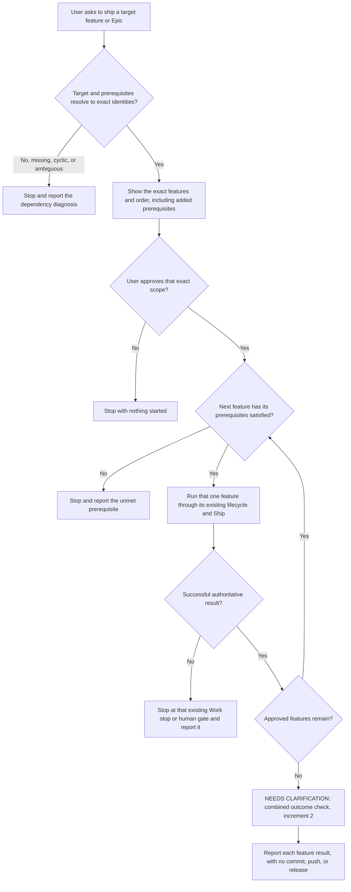

# Idea: Epic And Multi-Feature Ship

## Idea

At 2026-10-19T21:58:17.885Z, while discussing progress reporting in `.dude/ideas/067-work-type-presentation.md`, the user wrote:

> does it needs to be in a different draft? or would it be better if we plan ahead in 067? This situation  also brings an interesting scenario that I've seen before. There aer some features that are related or depedents. Currentl Dude does not haev a continuity between features. This gives makes me think we need somethign like an Epic where many features are related and depend on each others. SO we can launch a ship loop thru an Epic covering a longer workscope and deliverring all thiose features. Thoughts ?

At 2026-10-19T22:09:13.223Z, after Dude suggested keeping progress reporting in 067 and capturing this direction on its own, the user replied:

> yes, balance oout the agreements, and capture them,  break them down as needed, consolidate the epic/ship multistep  in a new feature as needed

The user sees related and dependent features without continuity between them and is considering something like an Epic, which would tie many interdependent features into one longer scope of work so that one Ship loop could deliver all of them. The user asked for Dude's thoughts, so what an Epic means in Dude is still open.

## Open Questions

For definition; no answer is needed to capture this idea.

1. Should a first release only run features in dependency order, or also add a named Epic with its own goal and outcome check?
   Answer:
2. What is the smallest durable record that can hold an Epic's members, goal, acceptance condition, and the decisions and outputs passed between features?
   Answer:
3. When does a prerequisite count as satisfied, and how should the user approve prerequisites that would widen the requested scope?
   Answer:
4. When a feature stops at a blocker or human gate, should the run end or continue with independent features, and from which points may a request start or restart a run under Work's existing rules?
   Answer:
5. May a run include features already imported into tracked Beads execution, or only Lightweight features?
   Answer:

## Assumptions

No additional user assumptions supplied.

<!-- dude:managed:start -->
## Agreed So Far

The user's reply above accepted Dude's suggestion to capture this direction separately. Agreed at brainstorm level:

- 067 keeps its read-only progress reporting, and this idea holds continuity and execution across features.
- The work reuses what Dude already has, and a first scope runs features one at a time.
- Every feature keeps its own lifecycle, identity, authority, review, and approval rules.

The sections below are Dude's analysis and proposals for definition. They approve no command, storage, schema, or implementation.

## What Exists Today

Dude already records and shows some relationships between features. What it lacks is the loop the user describes, one that carries several dependent features through their lifecycles.

- `.dude/ideas/024-feature-focus-order.md` recorded the user's earlier wish for a Ship that implements several dependent features, and added `depends-on:` to idea frontmatter for read-only dependency and order views. It chose not to design for that Ship because nothing would call it then.
- `src/skills/dude-lightweight-execution/backlog.mjs` derives Blocked and Next groups and dependency notes from that field. A dependency counts as met only when its target is defined with every task done, so a target resolved without a package never meets it.
- Ship (`src/skills/dude-work-intake/SKILL.md`, `## Ship`) takes at most one target and never widens it, asks one disambiguation question instead of ranking candidates, and adds no scheduler. Work runs one task at a time in the lane it detects at the start; in tracked execution it ignores the feature selector and takes whatever Beads reports ready.
- The Beads import (`library/packs/beads/skills/dude-pack-beads-spec-import/SKILL.md`) creates one epic per feature to group that feature's tasks. It stays deferred and never executes, so it is not the cross-feature Epic meant here.

## Proposed Increment 1: Dependency Order

Dude proposes starting with dependency-aware sequential Ship. It would resolve the requested target and its declared prerequisites through exact identities and owners, show the exact features and order, and ask before adding anything the user did not request. It would then run one ready feature at a time through the existing lifecycle and Ship, moving on only after a successful authoritative result and a fresh check of the next feature's prerequisites.

Diagram 1, proposed from this discussion: one run over an approved scope. Nothing in it is implemented. The stops follow Dude's first-slice recommendation, question 4 holds the alternatives, and the outcome check belongs to increment 2.

Order comes only from declared dependencies, never from lifecycle numbers, titles, or relatedness. A prerequisite may already be satisfied, resolved without delivering anything, or still unfinished; how each case counts, and what evidence proves it, is question 3.

## Proposed Increment 2: Epic Continuity

Prerequisites alone may not capture the shared outcome the user wants from an Epic. A later slice could add an Epic with agreed members, a goal and acceptance condition, shared decisions, outputs handed from one feature to the next, progress derived from its features, and a final check that the combined outcome works.

Both slices stay in this one idea for now, and definition may split them if each proves independently deliverable. An Epic's storage, identity, command, and schema are open under questions 1 and 2, so this capture creates no `.dude/epics/` folder, registry, or shadow task board.

## Continuity Between Features

Continuity means carrying accepted contracts, decisions, artifacts, and evidence from one feature to the next. A shared title, or every member's tasks being done, does not prove that the whole works end to end. A feature that is already defined is not rewritten automatically to fit a new upstream result; changed intent or contracts go back through explicit brainstorm or define.

## Permissions And Stops

Approving a scope authorizes that scope and nothing more. A run does not enroll features silently, import into Beads, switch or fall back between lanes, or revive terminal Work, and it adds no automatic retry or resume after cancellation or supervisor loss. It commits, pushes, merges, and releases nothing, and it never bypasses UI mockup approval or another human-only gate. Every current Work outcome and stop keeps its meaning; reporting on an Epic weakens none of them.

For a first slice, Dude recommends ending the run at the first existing stop and reporting it instead of working around it. Questions 4 and 5 hold the open choices on blocked independent features, human gates, start and restart points, and tracked features.

## Worked Example: 067 And 087

The pair is an example only. 067 plans classification and progress information that `.dude/ideas/087-dude-canvas-routing-map.md` could later read. This capture writes no dependency field between them and does not assume 087 needs all of 067 deployed before its design starts. Once a shared contract is stable and accepted, 087's design could begin early, while implementation and mockups follow real evidence and dependencies. Dude's earlier chat suggestion that 087's mockup come after 067 ships was only a proposal for that pair.

## Completion And Delivery

Finishing a feature's implementation, accepting an Epic's combined outcome, and delivering through Git or a release are separate events. A request to ship an Epic never silently includes Git or release work.

## Left Out Of A First Version

A first version leaves out arbitrary composition or enforcement of pack workflows, which stays with 067's question 7, along with task-level interleaving across features, parallel scheduling, full portfolio tooling, a graph editor, and generic checkpoints or telemetry.
<!-- dude:managed:end -->

## Coordinator Log

- 2026-10-19T22:10:35Z - brainstorm: Staged the first capture of the user's Epic and multi-feature Ship direction from the 067 progress-reporting discussion, with current groundwork, two proposed increments, permission boundaries, a 067 and 087 worked example, and five open questions, for coordinator first-capture publication; no definition package, tasks, or implementation.
